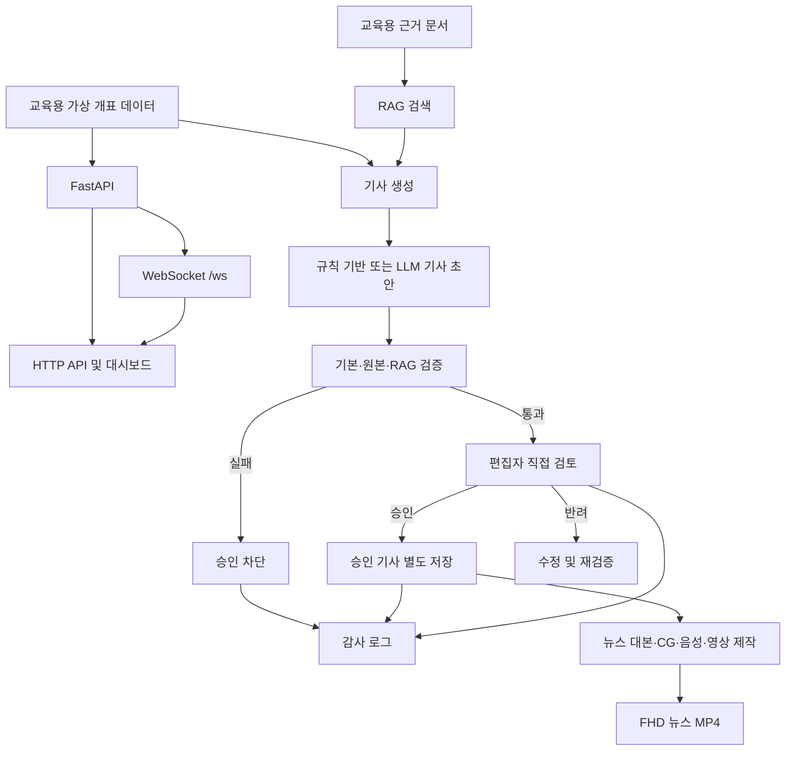

# AIJ-P1 | RAG 기반 가상 선거 개표 및 AI 뉴스 보도 시스템

**2026 한빛시 시장 선거 — AI 가상 개표 특집**


### 최종 AI 뉴스 영상 시청

**2026 한빛시 시장 선거 AI 가상 개표 특집**

[▶ 최종 뉴스 영상 시청하기 (Google Drive)](https://drive.google.com/file/d/1QvFlP_iatlrwPH9_il7MD83jNmfhx-fg/view?usp=sharing)

| 항목 | 내용 |
|---|---|
| 재생 시간 | 6분 50초 |
| 해상도 | FHD 1920 × 1080 |
| 화면 비율 | 16:9 |
| 프레임 속도 | 30fps |
| 파일 형식 | MP4 |
| 파일 용량 | 약 372.3MB |

※ 본 영상은 AI 데이터 저널리즘 교육용 가상 선거 보도입니다.
실제 선거 결과가 아니며, 생성형 AI 기술을 활용하여 제작되었습니다.


> 교육용 가상 선거 프로젝트입니다. 후보·정당·지역·개표 결과는 창작 설정이며 실제 선거와 무관합니다. AI 생성 기사는 사람의 검토와 승인 없이 최종 보도에 사용하지 않습니다.

- 과정: MBC 미디어캠퍼스 AI 기반 데이터 저널리스트 양성 과정
- 개발 형태: 개인 프로젝트(1인 개발)
- 개발자: 조남수
- 과제 수행 기간: 2026.11.18~11.27 (기관 일정)
- 대표 통합 테스트: 2026.11.25, 8개 항목 통과(아래 검증 범위 참조)

## 1. 프로젝트 소개

빠르게 바뀌는 개표 데이터를 정확하게 전달하기 위해 가상 선거 데이터 생성·분석, 실시간 웹 시각화, RAG 근거 검색, 기사 생성, 자동 팩트체크, 편집자 승인, AI 뉴스 영상 제작을 하나의 작업 흐름으로 연결한다. 실제 선거 API 대신 사전 제작한 교육용 데이터를 사용한다.

핵심 보도 질문: 개표 진행에 따라 선두 후보와 격차가 어떻게 달라지고 지역별 결과가 최종 순위에 어떤 영향을 주는가?

## 2. 가상 선거 설정과 최종 결과

| 항목 | 내용 |
|---|---|
| 선거 | 2026 한빛시 시장 선거 |
| 가상 선거일 | 2026.11.20 |
| 지역(기획 기준) | 중앙구, 동부구, 서부구, 남부구, 북부구 |
| 선거인 / 투표자 | 500,000명 / 350,000명 |
| 투표율 | 70.00% |
| 개표 단계 | 10단계 |
| 최종 개표율 | 100.00% |
| 데이터 출처 ID | `SYNTHETIC-STEP2-v1.0` |
| 최종 집계 기준시각(가상) | 2026.11.20 23:30 KST |

| 순위 | 후보 | 득표수 | 득표율 | 주요 공약 | 근거 ID |
|---|---|---:|---:|---|---|
| 1 | 심청 | 131,000 | 37.81% | 청년 주거 지원 | DOC-003 |
| 2 | 이몽룡 | 128,000 | 36.94% | 광역교통망 확충 | DOC-002 |
| 3 | 홍길동 | 87,500 | 25.25% | 소상공인 지원 | DOC-004 |

유효투표수 합계 346,500표, 투표자 수와의 차이 3,500표(무효표로 해석한 계산값), 1·2위 격차 3,000표(표시 득표율 기준 0.87%p). 개표 초반에는 이몽룡이 선두였고 최종 단계에는 심청이 선두로 바뀌었다. 이는 교육용 시나리오이며 실제 정치적 전망이 아니다.

## 3. 핵심 기능

- 개표 단계별 데이터 조회 및 후보별 득표율 추이 시각화
- WebSocket을 통한 10단계 JSON 전송(약 2초 간격), 재생·일시정지·재개·초기화 및 잘못된 명령 처리
- RAG 근거 문서 검색, 문서 ID와 공약 연결
- 규칙 기반 기사 초안 및 OpenAI LLM 기반 기사 생성
- 기본 검증, 원본 데이터 교차검증, RAG 근거 검증
- 편집자 검토·승인·반려, 검증 실패 시 승인 차단, 승인 파일 덮어쓰기 방지
- JSONL 감사 로그 및 원본 기사 SHA-256 기록
- 승인 기사를 기준으로 AI 앵커·음성·CG·자막을 결합한 뉴스 영상 제작

## 4. 기술 스택

| 영역 | 기술 |
|---|---|
| 개발 환경 | Windows 11, VS Code, Python 가상환경(.venv), PowerShell |
| 백엔드 | FastAPI, Uvicorn |
| 실시간 통신 | WebSocket, asyncio |
| 데이터·기록 | CSV/JSON(기획 및 데이터 구성), JSONL(승인 로그), SHA-256 |
| 기사 생성 | Python 규칙 기반 생성, RAG 검색, OpenAI LLM |
| 영상 | AI 앵커·립싱크·음성, 데이터 CG, CapCut 편집 자료 |
| 형상관리 | Git, GitHub |

기획서의 Python 목표 버전은 3.14.7이며 실제 실행 버전과 패키지 버전은 로컬에서 `python --version`, `python -m pip freeze`로 확인한다. pandas·Plotly·SQLite 등의 실제 채택 범위는 전체 소스코드 확인 후 확정한다. LLM 실행 출력에 기록된 모델명은 `gpt-6-luna`이며 실제 API 모델 식별자는 설정 및 요청 기록으로 별도 확인할 수 있다.

## 5. 시스템 아키텍처



영상 제작은 별도의 편집 작업이며 완전 자동 영상 생성 파이프라인을 의미하지 않는다.

## 6. 주요 파일 구조

아래는 실행 및 파일 목록으로 확인된 주요 경로만 발췌한 것이다.

```text
AIJ-P1/
├── run_server.ps1
├── src/
│   ├── STEP4_Dashboard/main.py
│   ├── STEP5_WebSocket/
│   ├── STEP6_RAG/
│   │   ├── document_loader.py
│   │   ├── rag_search.py
│   │   ├── article_generator.py
│   │   ├── llm_article_generator.py
│   │   └── test_api_key.py
│   └── STEP7_Validation/
│       ├── article_validator.py
│       └── article_approval.py
├── rag/
│   ├── articles/
│   │   ├── ai_article_step_10.json
│   │   ├── ai_article_step_10_error.json
│   │   ├── ai_article_step_10_no_evidence.json
│   │   └── ai_article_step_10_name_corrected_pending.json
│   ├── approved/
│   │   ├── approved_ai_article_step_10.json
│   │   └── approved_ai_article_step_10_name_corrected_pending.json
│   └── approval_log.jsonl
├── tests/
└── video/
    ├── audio/
    ├── charts/
    ├── clips/
    ├── images/
    └── output/
```

## 7. 설치 및 실행

프로젝트 루트에서 Windows PowerShell을 사용한다. 아래 가상환경 생성 및 의존성 설치는 새 환경을 위한 일반 절차이며, 실제 의존성 파일과 실행 버전은 저장소에서 확인해야 한다.

```powershell
python --version
python -m venv .venv
.\.venv\Scripts\Activate.ps1
# requirements.txt가 제공되는 경우에만 실행
# python -m pip install -r requirements.txt
.\run_server.ps1
```

기존 가상환경에서 검증된 서버 실행 명령은 ` .\run_server.ps1`이다. 실행 후 `Application startup complete.`를 확인한다. 종료는 서버 터미널에서 `Ctrl+C`.

| 페이지 | 주소 |
|---|---|
| 서버 상태 | http://127.0.0.1:8000/ |
| 개표 대시보드 | http://127.0.0.1:8000/dashboard |
| Swagger UI | http://127.0.0.1:8000/docs |

대시보드에서 조회 단계 선택 또는 하단의 실시간 개표 재생 버튼을 사용한다. LLM API 키는 개인 환경 설정으로 관리하며 저장소에 공개하지 않는다. 실제 키 설정명 및 `.env.example` 존재 여부는 제출 전 확인한다. 저장된 기사 조회와 규칙 기반 기사 생성은 실시간 LLM 생성과 구분한다.

## 8. API 명세

| 방식 | 경로 | 기능 |
|---|---|---|
| GET | `/` | 서버 상태 JSON |
| GET | `/api/election-results` | 개표 데이터 조회 |
| GET | `/dashboard` | 개표 대시보드 |
| GET | `/api/ai-article?step=10` | 저장된 AI 기사 조회 (step 기본값 10, 정수) |
| WebSocket | `/ws` | 개표 데이터 순차 전송 및 재생 제어 |

WebSocket 명령: `start`, `pause`, `resume`, `reset`. 단계별 `election_update`, 상태 변경 `playback_status`, 완료 `election_complete`, 미지원 명령 `error` 메시지를 사용한다. Swagger UI에는 WebSocket 경로가 표시되지 않는다.

## 9. RAG 기사 생성 및 검증 실행

별도 터미널에서 프로젝트 루트 및 가상환경을 유지한다.

```powershell
python .\src\STEP6_RAG\rag_search.py
python .\src\STEP6_RAG\article_generator.py
python .\src\STEP7_Validation\article_validator.py
```

LLM 기사 재생성은 API 비용과 기존 초안 갱신 가능성이 있으므로 필요할 때만 실행한다.

```powershell
python .\src\STEP6_RAG\llm_article_generator.py
```

승인 대상은 기본 기사 또는 실행 인자로 지정한 JSON 파일이다. 승인 메뉴에서 편집자 정보를 입력하고 직접 검토한 경우에만 승인한다. 이미 승인된 출력 파일은 덮어쓰지 않는다.

```powershell
python .\src\STEP7_Validation\article_approval.py
# 의도적으로 오류가 있는 교육용 테스트 기사
python .\src\STEP7_Validation\article_approval.py .\rag\articles\ai_article_step_10_error.json
python .\src\STEP7_Validation\article_approval.py .\rag\articles\ai_article_step_10_no_evidence.json
Get-Content .\rag\approval_log.jsonl -Encoding UTF8 -Tail 1
```

오류 기사에서 승인 메뉴 `1`을 선택하더라도 승인 차단되어야 한다. 승인/차단 실행은 감사 로그에 기록될 수 있다.

최종 영상 검증에 사용한 승인 기사: `rag/approved/approved_ai_article_step_10_name_corrected_pending.json` (파일명에 pending이 남아 있지만 내부 status는 승인). 승인 원본 SHA-256 확인:

```powershell
Get-FileHash .\rag\articles\ai_article_step_10_name_corrected_pending.json -Algorithm SHA256
```

기대값: `941c362f75ce3739fece11571a6dbc95fe6af29df79d1213a78f0f0470a5c7a1`

## 10. 대표 통합 테스트 결과

검증일: 2026.11.25. 사용자 실행 화면·터미널 출력·기존 승인 로그에 근거한 수동 통합 테스트이다.

| ID | 항목 | 결과 |
|---|---|---|
| TC-01 | 서버 실행 | PASS |
| TC-02 | 기본 HTTP/JSON 응답 및 기사 조회 | PASS |
| TC-03 | 대시보드 및 수동 개표 단계 변경 | PASS |
| TC-04 | WebSocket 10단계 전송, 콘솔 재생 제어, UI 완료 표시 | PASS |
| TC-05 | RAG 3개 질문 검색, 규칙·LLM 기사 생성 및 저장 | PASS |
| TC-06 | 정상 기사 및 수치 오류·근거 누락 검출 | PASS |
| TC-07 | 기존 승인 기록, 중복 승인 방지, 오류 차단, 감사 로그, 승인 원본 해시 | PASS |
| TC-08 | 영상 규격 및 사용자 직접 재생·내용 검토 | PASS |

| 검사 | 정상 기사 | 수치 오류 | 근거 누락 |
|---|---|---|---|
| 기본 | PASS | FAIL | FAIL |
| 원본 교차검증 | PASS | FAIL | PASS |
| RAG | PASS | PASS | FAIL |
| 승인 | 가능(기존 승인 이력 확인) | 차단 | 차단 |
| 테스트 판정 | PASS | PASS | PASS |

정상 기사 대표 검사 19개(기본 6, 원본 10, RAG 3). 수치 오류 기사에서 5개 오류를 검출했고 근거 누락 기사에서는 수치가 정확해도 승인을 차단했다. 상세 결과는 [통합 테스트 결과서](STEP9_Integration_Test.md) 참조(함께 저장할 경우).

## 11. 최종 뉴스 영상

파일: `video/output/AIJ_P1_2026_한빛시_시장선거_AI가상개표특집_final.mp4`

| 항목 | 실제 결과 |
|---|---|
| 길이 | 6분 50초 |
| 해상도 | 1920 × 1080 (FHD, 16:9) |
| 프레임 속도 | 30fps |
| 파일 크기 | 372,304,248 bytes (약 372.3 MB) |
| 오디오 | 스테레오, 44.1 kHz |
| 내용 검토 | 사용자 직접 재생 및 10개 항목 확인 완료 |

대용량 영상은 일반 Git 커밋 대신 별도 제출 파일 또는 접근 권한을 확인한 공유 링크로 제공한다. 공개 링크는 아직 확인되지 않았다.

## 12. 한계 및 개선 방향

- 실제 선거 API가 아닌 내부 교육용 창작 데이터를 사용하며 외부 공식 원문 URL은 없다.
- RAG 검색은 세 가지 대표 질문에서 확인했으며 전체 검색 성능이나 의미적 사실 검증 정확도를 측정한 것은 아니다.
- WebSocket의 서버 측 재생 제어와 UI 완료 표시는 검증했으나 단계별 모든 UI 수치 갱신, UI 재생 제어 버튼 전체, 연결 복구 등은 추가 검증 대상이다.
- AI 보조 판정과 규칙 판정 불일치 처리, 새 환경 재현성, API 키 없는 전체 데모 재현은 별도 확인이 필요하다.
- 승인 원본 해시는 일치했으나 승인 결과 파일 전체의 무결성을 검증한 것은 아니다. 11월 25일 재생성 초안은 기존 승인본과 문장이 다르므로 승인본과 구분한다.
- 중복 승인 차단 경로에서 로그 저장 전에 반환하는 코드가 확인되었다. 해당 시도도 감사 로그에 남기도록 개선할 수 있다.
- 가상 집계 기준시각과 실제 편집 승인 시각은 다른 의미이다. 후보명 수정 전 자료와 수정 후 자료를 구분한다.
- 공개 전 API 키, 개인정보, 저작권, 영상 공유 권한, `.gitignore` 및 과거 Git 이력을 점검한다.

## 13. 개발 기여 및 참고 자료

개인 프로젝트로 기획, 데이터 처리, 웹서비스, RAG·기사 생성, 검증·승인, 영상 제작 및 통합 테스트를 수행했다. AI 도구는 코드 및 콘텐츠 제작을 보조하며 최종 검토 책임은 사람에게 있다.

참고: 기관 「RAG 모델 기반의 선거 보도 구성하기」 작업지시서, STEP 1 프로젝트 기획서(2026.11.11), 2026.11.25 실행 증빙 및 승인 기록.
